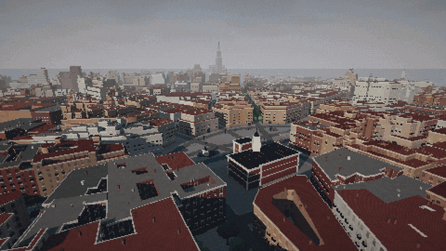
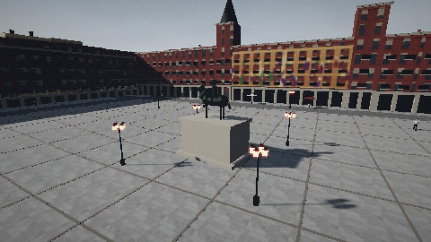
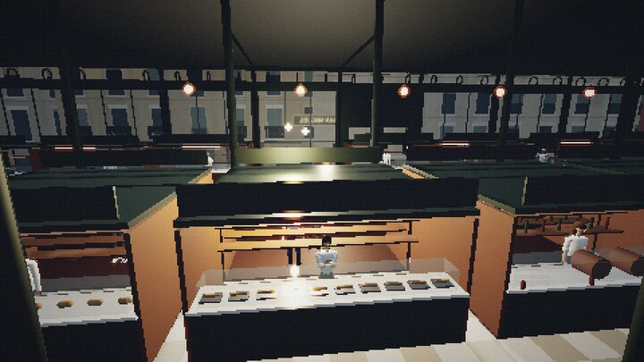
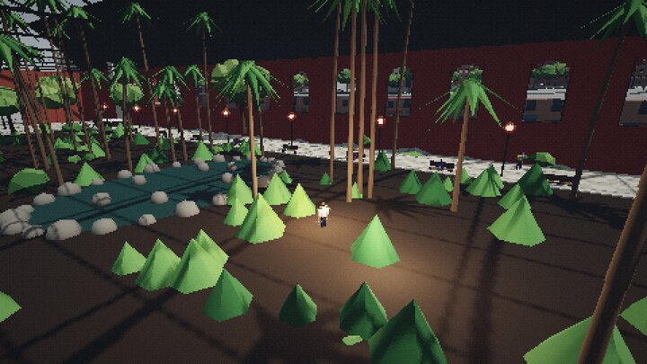
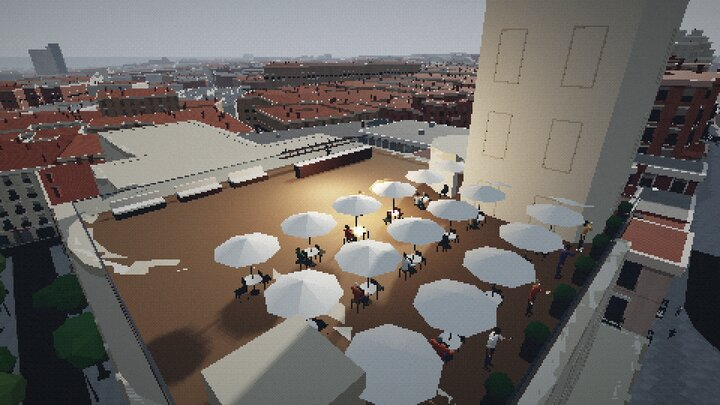
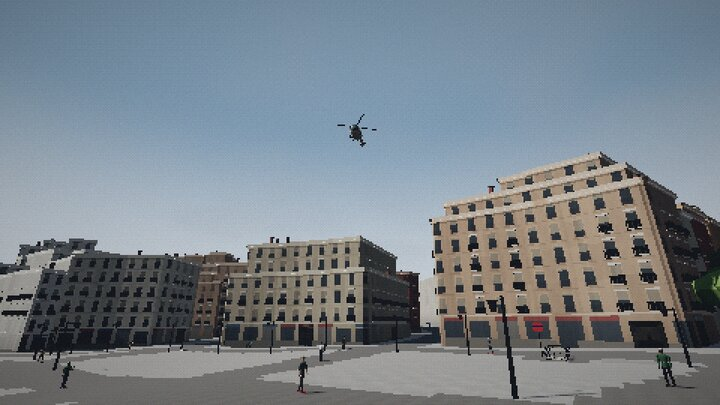
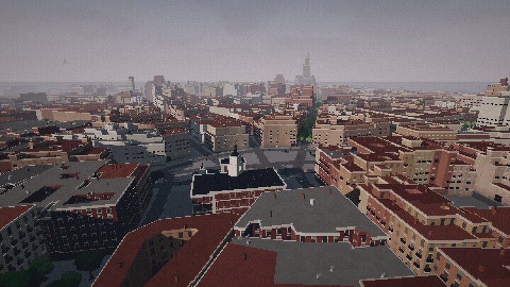
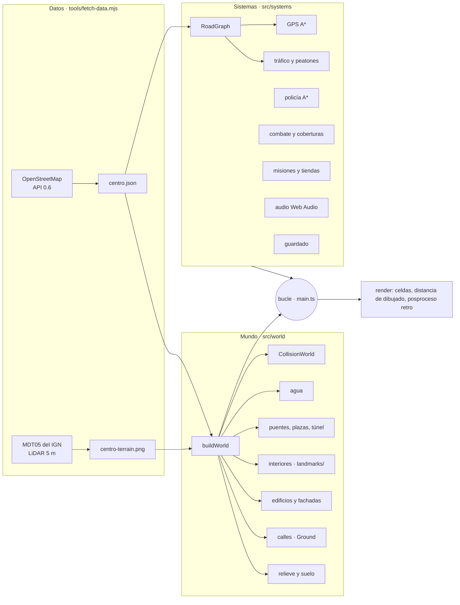

# MADRIZ

[](https://github.com/martinvera02/madriz/actions/workflows/ci.yml)

**Un mundo abierto estilo GTA sobre el Madrid real, a escala 1:1, que se juega en el navegador.**
Calles, edificios, parques y relieve salen de OpenStreetMap y del LiDAR del IGN; encima, conducción con
física, tráfico y peatones que siguen la red viaria real, policía que te persigue por las calles, misiones,
interiores en los que se entra andando y una ciudad que cambia del día a la noche.

**[▶ Jugar la demo](https://martinvera02.github.io/madriz/)** · navegador de escritorio con WebGL 2 · descarga ~3 MB



| | | |
|---|---|---|
|  |  |  |
| Puente de Segovia y Madrid Río | Mercado de San Miguel por dentro | Jardín tropical de Atocha |
|  |  |  |
| Azotea del Círculo de Bellas Artes | Cinco estrellas: llega el helicóptero | El centro de Madrid desde el aire |

## Qué hay

- **Madrid real, 1:1**: unos 16.000 edificios con su altura, calles con su ancho y sus sentidos, parques, el
  Manzanares, fuentes y estanques, y el relieve del LiDAR (la cuesta de la calle Segovia se nota al volante).
- **Monumentos y lugares reconocibles**: Plaza Mayor, Puente de Segovia y los puentes de Madrid Río, Plaza de España
  con el túnel de Bailén, Atocha, Gran Vía, el Viaducto…
- **Interiores sin pantallas de carga**: Mercado de San Miguel, Chocolatería San Ginés, la estación de Atocha con su
  jardín tropical y el Círculo de Bellas Artes, con ascensor hasta la azotea. Gente con la que hablar y a la que pedir.
- **Conducción** con modelo de neumáticos, transferencia de pesos y cambio de marchas; daños visibles (abolladuras,
  cristales, faros, ruedas pinchadas, incendio).
- **Ciudad viva**: tráfico con semáforos, peatones, vecinos con rutinas, ciclo de día y noche, lluvia, música
  callejera y sonido ambiente sintetizado con Web Audio.
- **Acción**: armas, coberturas, policía de 1 a 5 estrellas (patrullas, UIP, controles y helicóptero), seis misiones,
  armería y taller.
- **GPS**: minimapa, mapa completo con destino marcado y ruta más rápida (A*) en coche o a pie.
- **Partida guardada** y opciones (calidad gráfica, distancia de dibujado, sombras, sensibilidad…).

## Cómo está hecho

TypeScript estricto, Three.js r170 y Vite, sin motor de juego: unas 18.000 líneas propias.



### Decisiones técnicas

- **Datos reales en un JSON propio.** `tools/fetch-data.mjs` descarga OSM y el relieve, proyecta todo a metros desde
  el Kilómetro Cero (X este, Z sur) y lo guarda en un formato compacto: el juego no depende de servicios externos al
  arrancar. Los datos de OSM traen trampas (puentes etiquetados como edificios, alturas a 0); hay tests que las buscan.
- **Un solo `Ground.heightAt(x, z, y)` para todo lo que se pisa**: terreno, aceras, tableros de puente y suelos
  interiores. La altura actual `y` decide si estás encima del puente o debajo, o en qué planta del edificio; así los
  sótanos y el túnel de Bailén funcionan bajo la calle sin casos especiales.
- **Colisiones 2,5D** en una rejilla espacial de 20 m: segmentos (fachadas), cajas, círculos y techos, cada uno con
  altura de base y de techo. Las personas y los coches se resuelven como círculos empujados fuera de los sólidos.
- **Rendimiento**: la ciudad se fusiona en pocas geometrías por material, se trocea en celdas de 260 m y cada
  categoría (edificios, mobiliario, árboles, azoteas) tiene su distancia de dibujado. Árboles, farolas y cachivaches
  van con instancias.
- **Dos modelos de coche**: el del jugador con modelo de bicicleta, curva de neumático tipo Pacejka simplificada,
  transferencia de pesos y caja de cambios; el tráfico con un modelo arcade más barato.
- **Búsqueda de caminos A*** con montículo binario sobre el grafo real de OSM, respetando sentidos únicos en coche;
  la policía usa un grafo sin sentidos que incluye calles peatonales.
- **Interiores sin cargas**: cada edificio emblemático sustituye su bloque de OSM por un modelo propio construido con
  un kit de arquitectura en coordenadas locales (muros con huecos, forjados, escaleras, bóvedas, mobiliario); el
  terreno se recorta debajo para que quepan sótanos y escaleras.
- **Daños por vértices**: abolladuras deformando la malla del coche con un límite respecto a la forma original;
  cristales y faros se rompen colapsando sus triángulos.
- **Sonido casi todo sintetizado**: motores, ciudad, lluvia, sirena y rotor con osciladores, ruido filtrado y
  paneo 3D de Web Audio; solo los disparos y recargas son muestras (CC).
- **Calidad**: 43 tests con Vitest sobre los módulos puros (colisiones, suelos, A*, daños, coberturas, guardado,
  integridad de los datos) y GitHub Actions en cada push. La demo se publica sola en GitHub Pages.

## Arrancar

```bash
npm install
node tools/fetch-data.mjs centro   # descarga OSM + relieve → public/data/ (solo la primera vez, ~2 min)
npm run dev                        # abre http://localhost:5173
npm run build                      # comprueba tipos y genera la build de producción en dist/
npm test                           # tests (Vitest): colisiones, suelos, GPS, partida guardada, datos del mapa
```

Cada push a `main` pasa por GitHub Actions (`.github/workflows/ci.yml`): tests, tipos y build; y
`.github/workflows/pages.yml` publica la demo en GitHub Pages.

Parámetros de URL: `?hora=22` (0–24) para cambiar la hora de inicio (por defecto, el anochecer), `?lluvia` para empezar lloviendo, `?zona=centro` para elegir zona.

## Controles

| Tecla | Acción |
|---|---|
| WASD / flechas | Moverse / conducir |
| Ratón | Cámara (clic para capturar el puntero) |
| Shift | Correr |
| Espacio | Saltar / freno de mano (derrape) |
| F | Subir / bajar del coche (o robarlo si tiene conductor) |
| S | Frenar y, parado, marcha atrás |
| Q | Claxon (en coche) · a pie, ponerse a cubierto / salir |
| C | Mirar atrás (conduciendo) |
| L | Luces: automáticas → encendidas → apagadas |
| R | Enderezar el coche |
| V | Primera / tercera persona (a pie y al volante) |
| E | Hablar con la gente de los interiores y pedir · ascensores · empezar misión (marcador naranja) · armería · taller · hablar con la gente · entrar y salir de bares y tiendas · pedir en el mostrador (cuesta dinero) · echar una moneda a Lucía |
| 1–5 / rueda | Puños, bate, pistola, subfusil, escopeta |
| Clic derecho | Apuntar (cámara al hombro) / guardia con los puños |
| Clic izquierdo | Disparar / golpear |
| R (a pie) | Recargar |
| J | Lluvia sí / no |
| P | Imagen: retro → retro fuerte → nítida |
| M | Mapa completo: marcar destino y ruta más rápida (la música y el volumen están en la pausa) |
| N | Acelerar el reloj (x1 → x20 → x120) |
| H | Mostrar / ocultar ayuda |
| Esc | Pausa: continuar, guardar, cargar, nueva partida y opciones |

Mando (mapeo estándar): RT/LT acelerar/frenar, stick izquierdo dirección/andar, stick derecho cámara,
A freno de mano / saltar, X correr, Y subir/bajar, L3 o B claxon, R3 mirar atrás, Select enderezar,
Start pausa, cruceta arriba primera / tercera persona.

## Estructura

```
.github/workflows/          ci.yml (tests, tipos y build) · pages.yml (publica la demo)
docs/                       CHANGELOG.md, plan-monumentos.md y las capturas del README (media/)
tools/fetch-data.mjs        descarga OSM (API 0.6) + relieve (terrarium) y genera public/data/<zona>.json/.bin
tests/                      Vitest: colisiones, Ground.heightAt, A* del GPS, guardado, lugares, datos del mapa
src/
  main.ts                   sistemas de juego, bucle, interacción (E/F), pausa y guardado
  config.ts                 utilidades (RNG con semilla, ángulos…)
  world/
    buildWorld.ts           monta la ciudad entera y la trocea en celdas (no crea sistemas de juego)
    realData.ts             formato de los datos y carga
    terrain.ts              relieve + suelo pintado (zonas, calles peatonales) + minimapa
    roads.ts                calzadas 3D, marcas viales, pasos de cebra (Ground = suelo + tableros + suelos interiores)
    buildings.ts            extrusión de edificios con patios, colisiones por aristas
    buildingMaterial.ts     shader de fachadas (6 estilos)
    iconic.ts               fachadas y remates de los edificios emblemáticos, fuentes y estatuas
    landmarks/              edificios con interior: common.ts (tipos, gente, rótulos) y un archivo por edificio
    arch.ts                 Kit: muros con huecos, forjados, escaleras, bóvedas y mobiliario en coordenadas locales
    urban.ts                puentes de Madrid Río, Plaza Mayor, Plaza de España y el túnel de Bailén
    water.ts                Manzanares, estanques y fuentes
    places.ts               verde alrededor y nombre del lugar
    props.ts                árboles y farolas
    collision.ts, sky.ts
  entities/  character.ts, player.ts, vehicle.ts, fpArms.ts
  systems/   roadGraph.ts, navigation.ts, traffic.ts, pedestrians.ts, police.ts, missions.ts, save.ts…
  render/    retroPost.ts, streaming.ts
  ui/        hud.ts, worldMap.ts
```

## Datos y licencias

Calles, edificios y monumentos: © colaboradores de OpenStreetMap, licencia ODbL (hay que mantener la atribución).
Relieve: MDT05 © Instituto Geográfico Nacional, licencia CC BY 4.0 (alternativa: Mapzen Terrain Tiles, AWS Open Data).

Sonidos (`public/sfx/`, recortados y convertidos a MP3):
- Disparos (`pistola`, `subfusil`, `escopeta`): «Gunshot Sounds» de Tabasco en OpenGameArt.org
  (https://opengameart.org/content/gunshot-sounds). La página lo marca como CC0, pero el texto incluido indica
  © 2009 Vincent Sevedge, CC BY 3.0, así que se acredita igualmente.
- Recargas (`recarga-*`): «Gun reload sounds» de SpringySpringo en OpenGameArt.org, CC0
  (https://opengameart.org/content/gun-reload-sounds).
Si no cargan, el juego vuelve a los sonidos sintetizados.

## Depuración (consola del navegador)

```js
__madriz.tp(0, 0)            // teletransporte (metros desde el Kilómetro Cero; X = este, Z = sur)
__madriz.sky.time = 21       // cambiar la hora
__madriz.cam([x,y,z],[tx,ty,tz]) / __madriz.cam(null)   // cámara libre
```

## Historial

Cada versión, con lo que trae y sus límites conocidos: [docs/CHANGELOG.md](docs/CHANGELOG.md).
